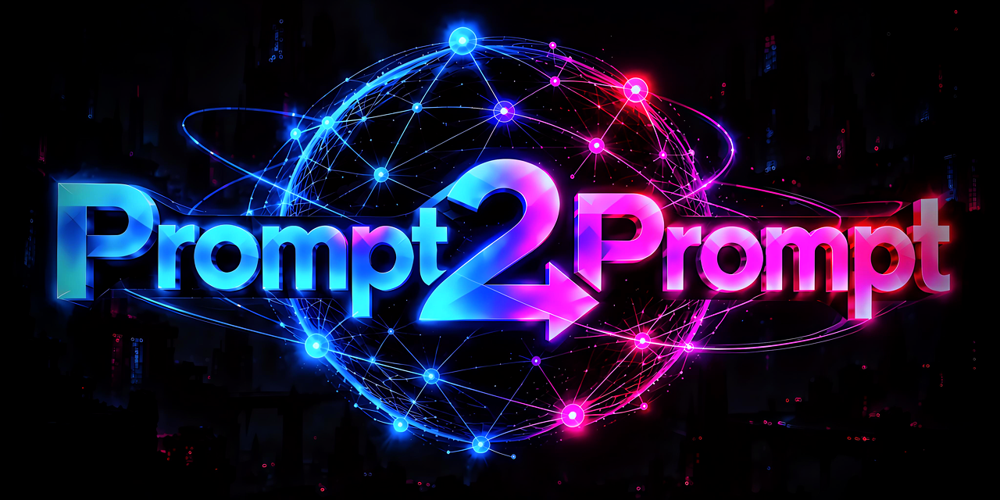

<p align="center"></p>

# P2P — Prompt to Prompt

**A prompt that writes prompts.** Describe your task in your own words — P2P builds one precise, ready prompt for it, written in the syntax of the model that will run it.

P2P 9 ships as a **Claude plugin** (Claude Code, Cowork, claude.ai). A file edition for other models (Gemini, GPT, Qwen and others) is attached to each release.

---

## Why not just copy a good prompt?

You can copy anything — someone's mega-prompt, a "perfect" system prompt from a thread. Often it turns to noise in your hands. A prompt written for one task carries its author's goal, knowledge and assumptions; laid over your task, they collide with yours. And the same text behaves differently on Claude, Gemini or GPT: each family was trained on different structure and reads it differently.

P2P doesn't solve your task. It writes the prompt for **your** task, for **your** model. Think of it as a travel adapter: you plug in and stop thinking about the voltage of each socket.

It is not a holy grail. It covers most everyday prompt work; the rest is your own expertise and finishing touches — but you start from a sound base instead of stitched-together pieces.

## Install

**claude.ai or the desktop app (recommended — updates arrive by themselves):**
**Customize** (left sidebar) → Plugins → Add → add marketplace `sanic732/P2P`, keep "Sync automatically" on, then add **P2P — Prompt to Prompt**. It appears in chat, Cowork and Claude Code.

**Claude Code terminal:**

```
/plugin marketplace add sanic732/P2P
/plugin install p2p@P2P
```

Upgrading from 8.x: the plugin is now called `p2p` (it was `p2p-v8c3`) — remove the old one and add P2P — Prompt to Prompt once; after that updates come automatically.

## Use

```
/p2p <model> <your task, in your own words>
```

```
/p2p Gemini a system prompt for a support bot of an online shop
/p2p Claude a technical brief for publishing my project on GitHub: files are in …, I want …
```

The more context you give — what you want, for whom, what the result should look like — the better the prompt. Write in any language; P2P answers in yours (`/p2p:lang` to fix it).

A real example: [a technical brief for publishing a repository](examples/github-release-brief.txt) — dictated in plain words, turned by P2P into a ready start prompt for Claude Code (8.x era).

`/p2p:menu` opens the full menu — over forty functions, from quick prompts to prompt audits.

## P2P in a few pictures

- **An operating system over the LLM, not "a good prompt".** Routing between models, knowledge bases pulled in on demand, protective patches for each architecture.
- **A mirror of Claude Code's architecture.** The P2P core is what `CLAUDE.md` is in Claude Code; on-demand modules are Skills; protective patches are Hooks; the council of roles is subagents. One way of thinking, two implementations — with an honest caveat: a hook is executed by the runtime, always; a P2P patch is executed by the model's attention, like any prompt, probabilistically.
- **Lost-in-the-Middle doesn't care about the platform.** A monolithic mega-prompt degrades exactly like a 600-line `CLAUDE.md`. So P2P is not one long sheet but layers, priorities and loading on demand.
- **Countermeasures, not faith.** Every P2P technique is an engineering answer to a specific model behaviour: losing the middle, overflowing the window, mistaking text for an instruction.
- **One contract, repacked for each model.** The meaning of the task stays the same; the syntax is native: XML for Claude, Markdown for Gemini, JSON for Grok.
- **You call it, you don't hope for it.** P2P starts with an explicit `/p2p` command — you don't wait for the system to guess the moment.
## How P2P is built — and why

P2P is plain text: Markdown files you can open and read. **No scripts, no hooks, no network calls, nothing collected.** Nothing runs on its own — you call it, it works, it stops.

It is organised like a small operating system, so the model knows *where to look* instead of holding everything at once:

| Layer | What it holds |
|---|---|
| **Index → preloader** | the entry point and settings — the role `CLAUDE.md` plays in a project, made portable to any chat |
| **Core** | the main logic: read the request (SIR scanner), estimate complexity (Tier T0–T4), pick a route |
| **Knowledge base** | prompt-engineering rules that don't age with model versions: Claude reads XML best, Gemini — Markdown, Grok — a JSON schema; the nine-step Contract Builder; templates |
| **Vendors** | how to write for each model family |
| **Modules** | read only when the task needs them: RAG, reasoning chains, routing, compression, security audit, optimization |
| **Live Specs** *(optional)* | a metrics layer: exact model ids, prices, context windows, known model failures — see below |

**A contract, not a template.** A template is a form to fill in. P2P writes a contract: role, goal, rules in pairs (what the model must do and what it must not), success criteria and how to check them.

**A council when it pays off.** For hard tasks QUORUM convenes up to eight expert roles — researcher, architect, critic, code specialist, data analyst, security engineer, integrator, synthesizer. In Claude Code and Cowork they run as real subagents; in chat, as roles inside one answer. Calling all eight for a small task is like sending special forces to get a kitten off a tree — so smaller councils exist too.

**Grown from feedback.** P2P has been developed in the open since early 2026, release by release. People use it in ways its author never planned — and those reports shaped much of what it is now.

## Live Specs — fresh model data, optional

The prompt techniques and the rules of each model family work without any extra file. If you work through APIs with many models and need today's exact ids, prices, windows and the status of known model failures (G-errors, confirmed by at least two independent reports), take `live_specs.md` from the assets of the [latest release](https://github.com/sanic732/P2P/releases) and attach it to the conversation or put it in your project. Menu item [41] explains it. P2P downloads nothing by itself.

## Other models — the file edition

`P2P_9.0.0-M_en.zip` in each release is the same system as plain files for any chat that accepts attachments. Attach the files, type `/p2p <model> <task>`. Fresh model data comes the same way: attach the newer `live_specs.md`.

## License

MIT — see [LICENSE](LICENSE).
